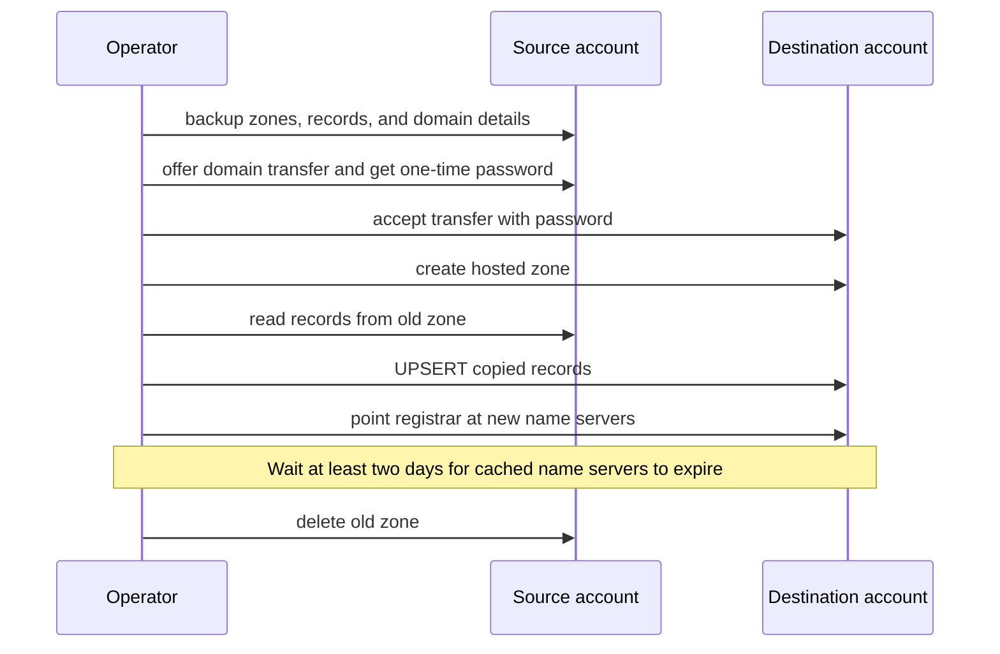

# Route 53 Migration Commands

Transferring a registered domain to another AWS account does not move its hosted zone. The registrar keeps pointing at the old zone, so DNS keeps working, but that zone is orphaned in the source account and the destination account has no zone for the domain. The `route53` command group does the full move. It snapshots the source account, transfers the registration, recreates the hosted zone in the destination, copies the records, repoints the registrar, and deletes the old zone.

`backup` only reads the source account and takes `--source-profile` alone. The other four commands require both `--source-profile` and `--dest-profile`. The source profile is the account the domain leaves. The destination profile is the account it moves into. The two profiles must resolve to different AWS accounts.

## How it works



## Workflow

Run `migration-status` before the first step and after each step. It shows where each domain stands and which command comes next.

1. `backup` snapshots every hosted zone and registered domain in the source account. It makes no changes.
2. `transfer` offers the domain from the source account and accepts it in the destination account.
3. `migrate-zone` creates the zone in the destination, copies the records, and repoints the registrar.
4. Wait about two days. Resolvers cache the old name servers until their TTL expires.
5. `cleanup` deletes the old zone in the source account.

## Commands

<!-- BEGIN GENERATED: commands -->
<!-- Generated by scripts/gen_docs.py -- do not edit between these markers. -->

### `route53 backup`

Snapshot every hosted zone and registered domain in the source account.

```bash
aws-cloud-utilities route53 backup [OPTIONS]
```

| Option | Value | Description |
|---|---|---|
| `--source-profile` | `TEXT` | **Required.** AWS profile of the account to snapshot |
| `--output-dir` | `TEXT` | Directory to write the snapshot into (default: <data-dir>/route53/<timestamp>) |

### `route53 cleanup`

Delete the old source zone once the registrar points at the destination.

```bash
aws-cloud-utilities route53 cleanup DOMAINS [OPTIONS]
```

| Option | Value | Description |
|---|---|---|
| `--source-profile` | `TEXT` | **Required.** AWS profile of the account domains move out of |
| `--dest-profile` | `TEXT` | **Required.** AWS profile of the account domains move into |
| `--confirm` | flag | Skip the confirmation prompt |

### `route53 migrate-zone`

Recreate the hosted zone in the destination and repoint the registrar.

```bash
aws-cloud-utilities route53 migrate-zone DOMAINS [OPTIONS]
```

| Option | Value | Description |
|---|---|---|
| `--source-profile` | `TEXT` | **Required.** AWS profile of the account domains move out of |
| `--dest-profile` | `TEXT` | **Required.** AWS profile of the account domains move into |

### `route53 migration-status`

Show each domain's registered account, zone location, and next step.

```bash
aws-cloud-utilities route53 migration-status [OPTIONS]
```

| Option | Value | Description |
|---|---|---|
| `--source-profile` | `TEXT` | **Required.** AWS profile of the account domains move out of |
| `--dest-profile` | `TEXT` | **Required.** AWS profile of the account domains move into |

### `route53 transfer`

Move domain registration from the source account to the destination.

```bash
aws-cloud-utilities route53 transfer DOMAINS [OPTIONS]
```

| Option | Value | Description |
|---|---|---|
| `--source-profile` | `TEXT` | **Required.** AWS profile of the account domains move out of |
| `--dest-profile` | `TEXT` | **Required.** AWS profile of the account domains move into |
| `--state-dir` | `TEXT` | Where to keep the one-time transfer password until accept succeeds (default: <data-dir>/route53) |

<!-- END GENERATED: commands -->

## What each command does

### migration-status

Shows each domain registered in either account, which account it is registered in, where its hosted zone lives (`source`, `dest`, `both`, or `none`), and the next command to run (`transfer`, `migrate-zone`, `cleanup`, or `done`).

### backup

Writes one JSON file per hosted zone in the source account, named `<zone>.<zone-id>.json`. Each file holds the zone, its delegation set (public zones), its VPC associations (private zones), and every record in it. It also writes `registered-domains.json` with the detail for each domain registered in the source account. Files are created readable only by you, since the domain details include registrant contact information. The command only reads from AWS.

The default output directory is `<data-dir>/route53/<timestamp>`, where the timestamp is UTC, such as `20260612T141500Z`.

### transfer

For each domain, the command offers the transfer from the source account to the destination account ID. It saves the one-time password, accepts the transfer in the destination account with that password, and waits for the accept operation to succeed.

The password is saved to `<state-dir>/transfers/<domain>.json` with mode 600. The file also holds the operation ID and the destination account ID. The password is valid for 3 days. The command deletes the file after the accept succeeds.

If the accept fails, the file stays on disk and the command prints the `aws route53domains accept-domain-transfer-from-another-aws-account` invocation to retry with before the password expires. Treat the file as a secret. Delete it if you abandon the transfer.

Domains run one at a time. If one fails, the command stops and the remaining domains are not offered.

### migrate-zone

For each domain, the command:

1. Refuses to run if the source account has no public hosted zone for the domain.
2. Refuses to run if the domain is not registered in the destination account. Run `transfer` first.
3. Creates a hosted zone with the same name in the destination account. If the destination already has a public zone for the domain, it reuses that zone.
4. Copies every record except the apex NS and SOA records. Route 53 creates those in the new zone. Alias records that point at the old zone are rewritten to point at the new zone. Records are written with `UPSERT` in batches sized to stay under the Route 53 change-batch limits (1000 record values and 32000 characters per batch). Records that reference a health check, traffic policy, or CIDR collection are refused up front, since those resources belong to the source account; recreate them in the destination by hand first.
5. Compares the record count in the destination with the count in the source. If they differ, the command stops before it changes the name servers. A reused zone with extra records fails this check.
6. Updates the registrar's name servers to the destination zone's name servers and waits for the operation to finish.
7. Prints a `dig` command you can use to check the new name server.

While the registrar change propagates, both zones answer the same records.

### cleanup

For each domain, the command refuses to run unless both accounts have a public hosted zone for the domain, the domain is registered in the destination account, the registrar's name servers match the destination zone's name servers, and the destination zone serves every non-apex record the source zone still has with the same values, TTL, and routing policy. A record added to the source after `migrate-zone` therefore blocks cleanup until you re-run `migrate-zone`. A refusal stops the run.

If the checks pass, the command reports how many records it will delete from the source zone and asks for confirmation. Answering no skips that domain and moves on to the next one. Otherwise it deletes the non-apex records, then deletes the source zone. Pass `--confirm` to skip the prompt.

The command does not check how much time has passed since `migrate-zone`. Wait at least two days yourself. That gives resolvers time to drop the old name servers from their caches.

## Examples

```bash
# Where does every domain stand?
aws-cloud-utilities route53 migration-status \
  --source-profile old-account \
  --dest-profile new-account

# Snapshot into the default directory
aws-cloud-utilities route53 backup --source-profile old-account

# Snapshot into a chosen directory
aws-cloud-utilities route53 backup \
  --source-profile old-account \
  --output-dir ./route53-snapshot

# Transfer one domain, then several in one run
aws-cloud-utilities route53 transfer \
  --source-profile old-account \
  --dest-profile new-account \
  example.com
aws-cloud-utilities route53 transfer \
  --source-profile old-account \
  --dest-profile new-account \
  example.com example.org

# Recreate the zone in the destination and repoint the registrar
aws-cloud-utilities route53 migrate-zone \
  --source-profile old-account \
  --dest-profile new-account \
  example.com

# Delete the old zone, with and without the prompt
aws-cloud-utilities route53 cleanup \
  --source-profile old-account \
  --dest-profile new-account \
  example.com
aws-cloud-utilities route53 cleanup \
  --source-profile old-account \
  --dest-profile new-account \
  --confirm \
  example.com
```

## Verifying

Run these after `migrate-zone`. Until the registrar change propagates, the first command returns the old name servers.

```bash
# The name servers the internet currently sees for the domain
dig +short NS example.com

# The name servers the new zone answers with. Use a name server from migrate-zone output.
dig +short NS example.com @ns-xxx.awsdns-xx.org
```

## After the move

Infrastructure as code that finds the zone by name in the source account will break. Terraform `data "aws_route53_zone"` blocks and CloudFormation stacks that reference the old zone ID need to target the destination account. Import the zone and its record resources into the destination account's state or stack. Make this change before `cleanup`, or the lookup fails once the source zone is gone. The records are already copied, so DNS does not change while you do this.

## Notes

- Domain arguments are normalised: case is ignored and a trailing dot is dropped.
- Registrar operations are polled every 15 seconds for up to 30 minutes, then the command fails with the operation ID so you can check it in the console.
- The `route53domains` API exists only in us-east-1. These commands pin that region for the domains client, so the global `--region` option has no effect on them.
- Snapshots and transfer state go under the data directory, `~/data/aws-cloud-utilities` by default. Set the `DATA_DIR` environment variable to change it.
